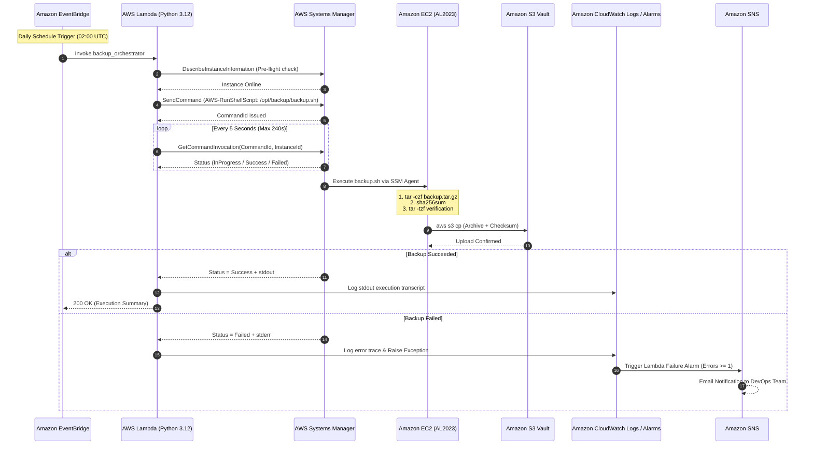

# System Architecture & Technical Specifications

## 1. Architectural Sequence Diagram

---

## 2. Least-Privilege IAM Permission Matrix

| Identity / Role | Associated Policy | Actions Permitted | Target Resource Scope | Security Justification |
| :--- | :--- | :--- | :--- | :--- |
| **EC2 Instance Role** | `AmazonSSMManagedInstanceCore` | `ssm:UpdateInstanceInformation`, `ssmmessages:*` | Outbound endpoints | Allows SSM Agent communication without opening Port 22 (SSH). |
| **EC2 Instance Role** | `cloud-backup-ec2-s3-policy` | `s3:PutObject`, `s3:GetObject`, `s3:ListBucket` | `arn:aws:s3:::cloud-backup-vault-*` | Allows uploading backups and downloading during restore drills. No bucket deletion or cross-bucket permissions. |
| **Lambda Role** | `AWSLambdaBasicExecutionRole` | `logs:CreateLogGroup`, `logs:CreateLogStream`, `logs:PutLogEvents` | `/aws/lambda/cloud-backup-orchestrator` | Logs script stdout/stderr and polling metrics to CloudWatch. |
| **Lambda Role** | `cloud-backup-lambda-ssm-policy` | `ssm:SendCommand`, `ssm:GetCommandInvocation`, `ssm:DescribeInstanceInformation` | `AWS-RunShellScript`, Instances | Dispatches backup shell script and polls execution status. |
| **EventBridge Service** | Lambda Resource Policy | `lambda:InvokeFunction` | `cloud-backup-orchestrator` | Triggers function strictly based on the scheduled daily rule. |

---

## 3. Resilience & Disaster Recovery Design

### Backup Integrity Guarantee
- Before uploading, `tar -tzf` validates that the archive table of contents is uncorrupted.
- `sha256sum` generates a cryptographic fingerprint uploaded alongside the `.tar.gz` archive as `.tar.gz.sha256`.
- Restoration executes `sha256sum --check` before decompressing files, preventing corrupt or truncated data from overwriting production state.

### S3 Storage Durability & Security
- **Durability:** 99.999999999% (11 9's) across multiple Availability Zones in `ap-south-1`.
- **Encryption at Rest:** Server-Side Encryption with Amazon S3 Managed Keys (`AES256`).
- **Access Control:** S3 Block Public Access enforces strict zero-trust boundary.
- **Cost Protection:** Automatic 14-day lifecycle expiration rule ensures storage never exceeds the 5 GB AWS Free Tier limit.
